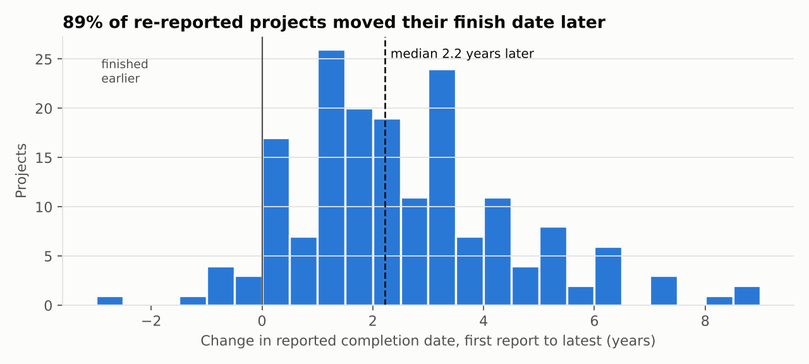
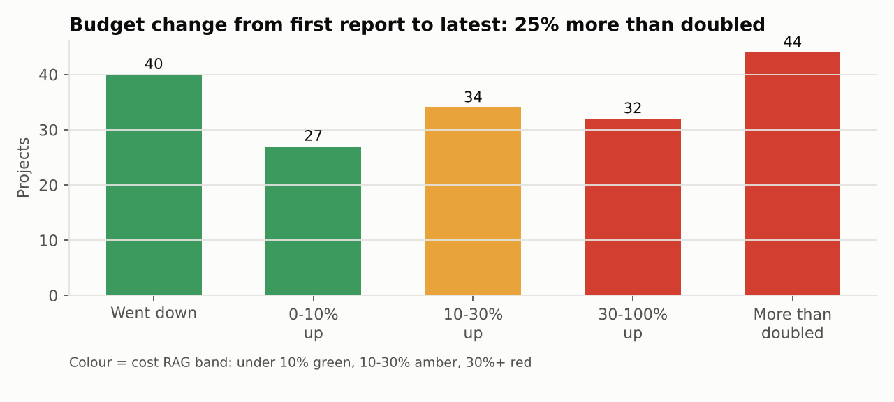
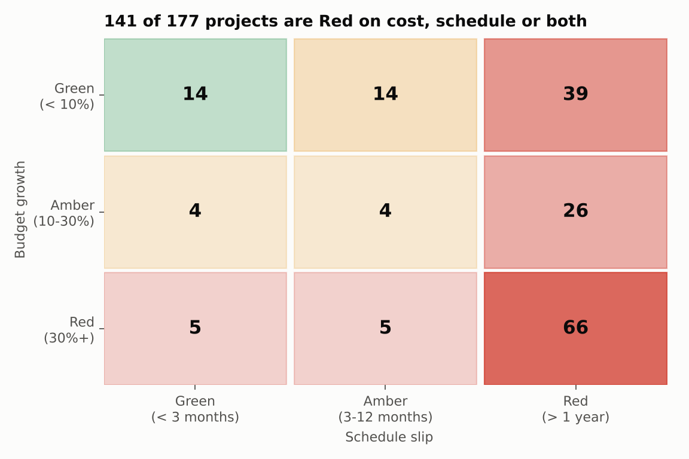
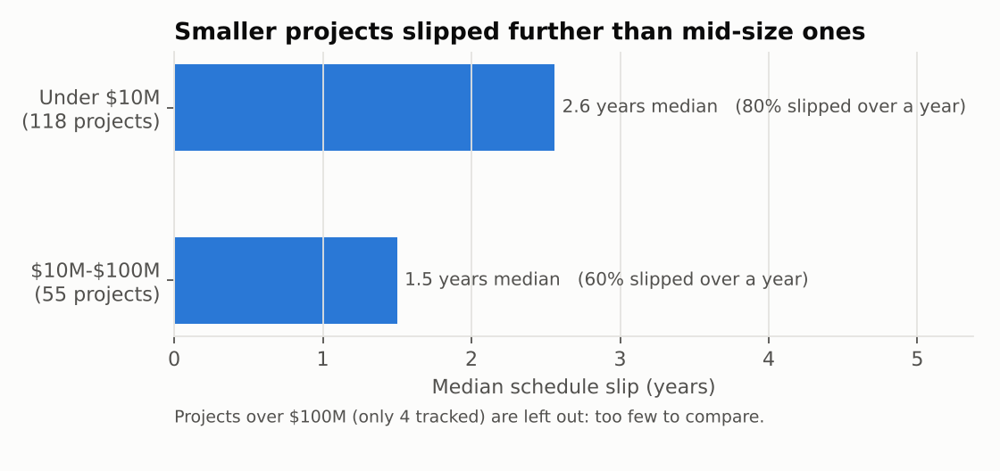
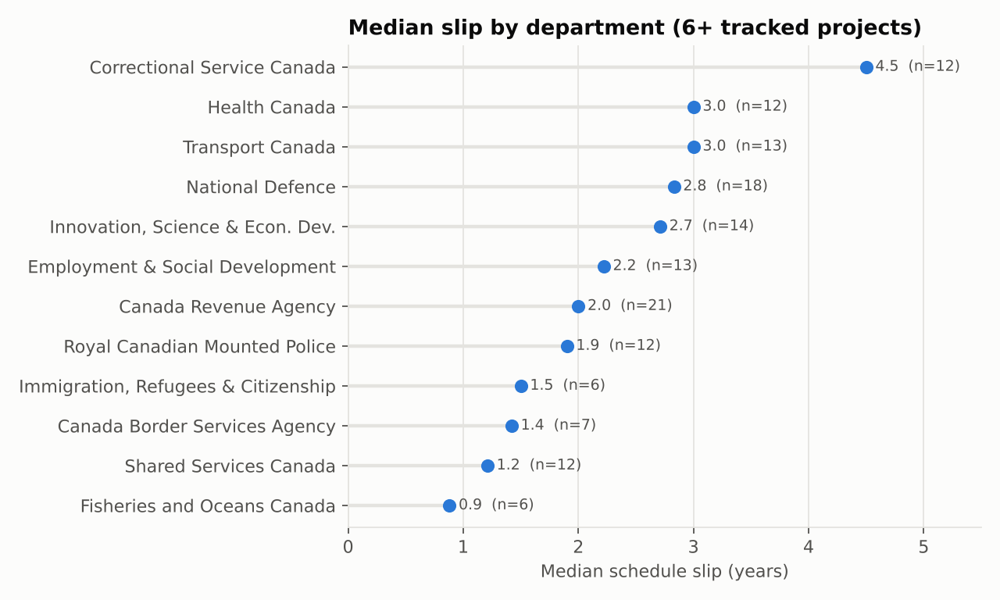

# IT portfolio health check: 1,126 Government of Canada IT projects, 2016-2022

A project-portfolio review of the kind a PMO runs before a governance board, done on public data. Three times (2016, 2019, 2022), the Government of Canada answered questions in Parliament by tabling a list of every federal IT project over $1 million, with its total budget and estimated completion date. 177 projects appear in more than one list, so their reported budget and finish date can be compared with themselves over time.

**The question:** across the portfolio, how far do budgets and schedules drift from what was first reported? Where is the drift worst, and what should a portfolio office do about it?

The analysis is in SQL (SQLite), with Python for loading and charts. The final table is ready for Power BI or Excel.

## Findings at a glance

| | |
| --- | --- |
| **Schedules slip, almost always** | 89% of the 177 re-reported projects moved their finish date later. The median slip was **2.2 years**, and 74% slipped by more than a year. |
| **Budgets grow** | The median budget rose 21%. 43% grew by 30% or more, and a quarter more than doubled. Together these projects went from $3.38B to $4.72B (+40%, +$1.34B). |
| **By standard thresholds, 4 in 5 are Red** | 141 of 177 (80%) are Red on cost, schedule or both. Only 14 (8%) are Green on both. |
| **Small projects slip more** | Projects under $10M slipped a median 2.6 years (80% by over a year). $10M-$100M projects slipped 1.5 years (60%). |
| **A slip predicts another slip** | Of 32 projects that slipped between 2016 and 2019, 29 (91%) slipped again by 2022. |
| **The watch list** | 115 tracked projects were still in flight at the April 2022 report, and 97 of them are Red. The 15 largest are listed below. |

**Read this before the numbers.** Only projects that appear in two reports, three years apart, can be tracked. A project planned and finished between two reports shows up only once, so it isn't counted. This group therefore leans towards long-running and troubled projects, and the percentages describe them, not every federal IT project. That said, they are exactly the projects a portfolio office should watch most closely.

## Data

| Report | As of | Projects | Total budget | Departments | No completion date given |
| --- | --- | ---: | ---: | ---: | ---: |
| Sessional paper 8555-421-266 | June 2016 | 398 | $11.92B | 37 | 10 |
| Sessional paper 8555-421-2460 | May 2019 | 463 | $7.03B | 37 | 44 |
| Sessional paper 8530-441-13-505 | April 2022 | 495 | $7.02B | 47 | 14 |

1,126 distinct projects across 55 departments. The CSVs in `data/raw/` come from the [Large Government of Canada IT projects](https://github.com/YOWCT/large-government-of-canada-it-projects) project by Ottawa Civic Tech, which extracted them from the tabled sessional papers and matched projects across years.

**Terms used:**
- **Baseline**: a project's budget and completion date in the first report it appears in.
- **Slip**: latest reported completion date minus baseline completion date, in years.
- **Budget change**: latest budget versus baseline budget, in %.
- **RAG rating**: Red / Amber / Green, defined in the next section.

## RAG framework

| Dimension | Green | Amber | Red |
| --- | --- | --- | --- |
| Cost (budget growth) | under 10% | 10% to 30% | 30% or more |
| Schedule (slip) | under 3 months | 3 to 12 months | over 12 months |
| Overall | Green on both | otherwise | Red on either |

The cost bands match the ones the US Federal IT Dashboard uses for cost variance. The schedule bands are mine, set in months because this data has no start dates, so slip can't be expressed as a % of duration.

## Findings

### 1. Finish dates move, and they move a lot



Only 19 of 177 projects kept or improved their finish date. The distribution has a long tail: 22 projects slipped by 5 years or more.

### 2. Budgets grow, though less consistently than schedules



40 projects (23%) reported a lower budget later, which can mean a scope cut or simply a better estimate. At the other end, 44 projects more than doubled. Some of these are phased projects whose later reports cover more phases. The source lists don't say, so I've treated every change as reported.

### 3. RAG view



Schedule is the bigger problem. 39 projects stayed within 10% on budget but still slipped more than a year. The reverse, Red on cost and Green on schedule, describes only 5.

### 4. Smaller projects slip further



Budget growth is similar for both bands (median +20% and +23%), but projects under $10M slip a year longer. One likely reason is oversight: in most governance frameworks, independent reviews and gating scale with budget, so small projects get the least scrutiny. Only 4 projects over $100M were tracked, too few to draw a conclusion.

### 5. By department



Among departments with at least 6 tracked projects, Correctional Service Canada has the longest median slip (4.5 years across 12 projects), and Fisheries and Oceans the shortest (0.9 years). National Defence has the highest share of Red projects: 17 of 18. Full table: [outputs/05_department_scorecard.csv](outputs/05_department_scorecard.csv).

### 6. A project that slips once usually slips again

| Between 2016 and 2019 | Projects | Slipped again 2019-2022 |
| --- | ---: | ---: |
| Finish date moved later | 32 | 29 (91%) |
| Finish date held or improved | 4 | 4 (100%) |

Only 36 projects appear in all three reports with dates each time, so this is a small group. Still, the pattern is strong: a first re-plan rarely holds. The 4 that held on the first re-plan all slipped later anyway.

### 7. Watch list: in flight at April 2022 and Red

The 15 largest by current budget ([full list](outputs/07_watch_list.csv)):

| Project | Department | Baseline $M | Latest $M | Budget change | Baseline due | Latest due | Slip (yrs) |
| --- | --- | ---: | ---: | ---: | --- | --- | ---: |
| Passport Program Modernization Initiative | IRCC | 28.7 | 187.6 | +554% | Dec 2018 | Nov 2022 | 4.0 |
| E-Procurement Solution (EPS) | PSPC | 45.9 | 144.1 | +214% | Dec 2019 | Jun 2023 | 3.5 |
| Benefits System Renewal Project | CRA | 79.0 | 143.0 | +81% | Mar 2020 | Mar 2023 | 3.0 |
| Export Import Controls System II | Global Affairs | 33.6 | 134.3 | +300% | Feb 2017 | Jun 2022 | 5.3 |
| ePassport Next Generation | IRCC | 99.6 | 92.7 | -7% | Feb 2022 | Mar 2023 | 1.1 |
| GCMS Disaster Recovery | IRCC | 52.3 | 89.7 | +72% | Aug 2020 | Sep 2023 | 3.1 |
| Offender Management System Modernization | CSC | 10.2 | 77.4 | +657% | Jul 2018 | Feb 2027 | 8.6 |
| Canada Pension Plan Enhancement | ESDC | 50.5 | 75.2 | +49% | Dec 2025 | Mar 2025 | -0.7 |
| Quantum 2.0 | CRA | 14.2 | 71.9 | +408% | Mar 2020 | Mar 2027 | 7.0 |
| Workload Migration Program | Statistics Canada | 37.3 | 63.7 | +71% | Mar 2022 | Mar 2023 | 1.0 |

IRCC = Immigration, Refugees and Citizenship Canada · PSPC = Public Services and Procurement Canada · CRA = Canada Revenue Agency · CSC = Correctional Service Canada · ESDC = Employment and Social Development Canada

## Recommendations for a portfolio office

| # | Recommendation | Based on |
| --- | --- | --- |
| 1 | **Treat the first re-plan as a trigger.** When a project moves its finish date for the first time, require a recovery review (root cause, re-estimate, independent check) before the new date is accepted. | 91% of projects that slipped once slipped again |
| 2 | **Don't exempt small projects from schedule assurance.** Add a lightweight schedule health check at each gate for projects under $10M, not only the large ones. | Under-$10M projects slip a median 2.6 years vs 1.5 |
| 3 | **Report the baseline alongside the current figures.** Each list gives only today's budget and date, and in 2019, 44 projects gave no completion date at all. Publishing baseline and current values side by side makes drift visible without matching reports by hand. | 68 project entries across the three reports had no completion date; matching across years depends on outside work |
| 4 | **Take the watch list to the next portfolio board.** For each of the 97 Red projects still in flight, record a decision: continue, re-scope, or stop. | Finding 7 |
| 5 | **Rate cost and schedule separately.** One overall colour hides that schedule is the dominant problem. | 39 projects Green on cost but Red on schedule |

## How to run it

```bash
pip install -r requirements.txt
python src/load.py      # data/raw/*.csv -> data/gc_it.db
python src/analyze.py   # runs sql/01-07, writes outputs/*.csv and outputs/charts/
```

## Using it in Power BI or Excel

`outputs/project_rag_full.csv` has one row per tracked project with every measure and RAG rating. Load it into Power BI (Get data → Text/CSV) to build a slicer-driven portfolio dashboard by department, size band and RAG status.

## Repo structure

```
data/raw/            the three tabled reports as CSV
sql/
  00_views.sql             baseline vs latest per project, RAG rating (window functions)
  01_portfolio_overview.sql
  02_variance_summary.sql  medians computed in SQL
  03_rag_matrix.sql
  04_size_bands.sql
  05_department_scorecard.sql
  06_repeat_slippage.sql   pivots the three reports with conditional aggregation
  07_watch_list.sql
src/load.py          cleans money and dates, loads SQLite
src/analyze.py       runs the SQL, saves results and charts
outputs/             results (CSV) and charts (PNG)
```

## Limitations

- **Selection bias:** only projects reported more than once are tracked (see the note at the top).
- **Self-reported figures:** departments supplied the numbers. They weren't audited.
- **Scope changes:** budget changes may reflect added scope or phases, not overruns. The reports don't separate the two.
- **Nominal dollars:** no adjustment for inflation.
- **Matching:** projects were matched across years by the Ottawa Civic Tech team. A renamed or split project may be missed.

---
Data: Government of Canada sessional papers 8555-421-266, 8555-421-2460 and 8530-441-13-505, as compiled by [Ottawa Civic Tech](https://github.com/YOWCT/large-government-of-canada-it-projects) (code MIT licence).
